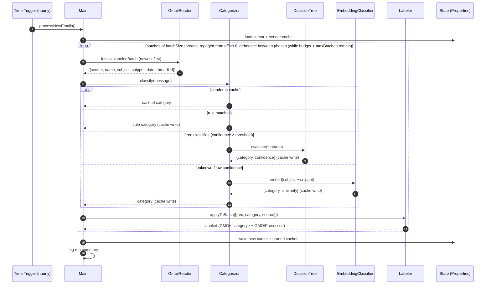

# Architecture — Gmail Monitor & Organizer

> **Google Apps Script** project that reads your own Gmail inbox, categorizes incoming
> e-mails using a **hybrid engine** (rule-based first, local decision tree, then a
> **free embedding-similarity tier**) and **marks each e-mail with a Gmail label for its category**
> (`GMO/<category>`, nested labels) — the mailbox itself becomes the organized archive.

---

## 1. High-Level Overview

```
┌──────────────────────────────────────────────────────────────────────────┐
│                        Google Apps Script Runtime                        │
│                                                                          │
│   ┌──────────────┐    ┌───────────────┐    ┌──────────────────────┐      │
│   │  GmailReader │───▶│  Categorizer  │───▶│       Labeler        │      │
│   │  (GmailApp)  │    │ rules+tree+AI │    │  (GmailApp labels)   │      │
│   └──────▲───────┘    └───────┬───────┘    └──────────┬───────────┘      │
│          │                    │ unknown senders       │                  │
│          │             ┌──────▼───────┐               │                  │
│          │             │  Embedding   │               │                  │
│          │             │ Classifier   │               │                  │
│          │             └──────────────┘               │                  │
│   ┌──────┴───────────────────────────────────────────▼───────────┐      │
│   │   Main (orchestrator)  ·  State (PropertiesService)  ·  Utils │      │
│   └───────────────────────────────────────────────────────────────┘      │
└──────────────────────────────────────────────────────────────────────────┘
          │                    │                          │
          ▼                    ▼                          ▼
   ┌────────────┐    ┌──────────────────┐    ┌───────────────────────────┐
   │   Gmail    │    │  Embedding API   │    │  Gmail labels (markers)   │
   │  (threads) │    │ (classification) │    │  ├─ GMO/shopping          │
   └────────────┘    └──────────────────┘    │  ├─ GMO/news              │
                                             │  ├─ GMO/ads               │
                                             │  ├─ GMO/newsletters       │
                                             │  ├─ GMO/finance           │
                                             │  ├─ GMO/job-search        │
                                             │  ├─ GMO/social            │
                                             │  ├─ GMO/work              │
                                             │  ├─ GMO/uncategorized     │
                                             │  └─ GMO/Processed (done)  │
                                             └───────────────────────────┘
                                                  (no external storage)
```

The system is a **single standalone Apps Script project** driven by a **time-based
trigger** (default: hourly). Every run is incremental: only messages that arrived since
the last successful run are inspected, and each processed thread is tagged with a Gmail
label so runs are **idempotent**.

---

## 2. Core Design Decisions

| # | Decision | Rationale |
|---|----------|-----------|
| 1 | **Hybrid categorization** — deterministic rules first, free embedding similarity only for senders with no matching rule | Fast, predictable for the bulk of mail; the free embedding model is consulted only for unknown senders |
| 2 | **Gmail labels as markers** — `GMO/<category>` nested labels applied to every processed thread | The mailbox itself is the storage; searchable, filterable, and zero external data |
| 3 | **Label-only persistence** — no spreadsheet or database | Verdicts persist in the per-sender cache; markers are labels alone; idempotent relabeling keeps retries safe |
| 4 | **Sender-level category cache** in `PropertiesService` | the embedding model is consulted **once per unknown sender per TTL** (`CONFIG.senderCacheTtlDays`, default 30 days) — not once per message |
| 5 | **Gmail label `GMO/Processed`** as the "done" marker | Robust idempotency that survives trigger retries and partial failures |
| 6 | **Config in `Config.gs` + Script Properties** | Categories/rules are editable code; secrets (API key) and mutable state live in Script Properties, never in source |
| 7 | **Time-budget guard + paced batches in the orchestrator** | Apps Script executions cap at 6 min; the run saves its cursor and exits before the cap, resuming next trigger. Each run walks unlabeled threads newest-first, repaging from offset 0 (labeled mail leaves the result set), with configurable debounces between the fetch/classify/label phases and chunked label writes |
| 8 | **Local decision-tree tier before similarity matching** | deterministic, auditable, zero-cost inference in pure JS — no libraries needed; the free embedding tier handles what the tree can't classify, and confirms the tree's probabilities with token similarity |

---

## 3. Module Layout

```
gmail-monitor-organizer/
├── README.md                 # User-facing guide (setup, usage, troubleshooting)
├── ARCHITECTURE.md           # This document
├── appsscript.json           # Apps Script manifest (scopes, timezone, logging)
├── .clasp.json               # clasp config (gitignored: contains script ID)
├── categories/               # Detection-pattern docs, one per category
└── src/
    ├── Main.gs               # Entry points: processNewEmails(), setupTriggers()
    ├── Config.gs             # Category definitions, rule sets, tunables
    ├── GmailReader.gs        # Gmail search, batched thread/message extraction
    ├── Categorizer.gs        # Hybrid engine: sender cache → rules → tree → embeddings
    ├── DecisionTree.gs       # Local decision-tree inference (JSON model, pure JS)
    ├── TreeModel.gs          # Generated: exported tree as a const (gitignore-safe)
    ├── EmbeddingClassifier.gs # Free embedding similarity: prototypes + cosine gates
    ├── Labeler.gs            # Gmail label markers: GMO/<id>, Processed, needs-review
    ├── Trainer.gs            # buildTreeFromLabels(): ID3 training from GMO/ labels → Drive JSON
    ├── State.gs              # Script Properties accessors (cursor, caches)
    └── Utils.gs              # Logging, retry/backoff, header parsing helpers
```

**Dependency direction** (one-way, no cycles):

```
Main ──▶ GmailReader ──▶ Categorizer ──▶ DecisionTree (JSON model)
Main ──▶ Trainer ─────▶ GmailReader (extract) + DecisionTree (features) → Drive JSON
  │                        │      │            │
  │                        │      │            └──▶ EmbeddingClassifier (low confidence only)
  │                        │      └──▶ State (sender cache)
  └──▶ Labeler ───────────┴─────────▶ State
                 │
                 └──▶ GmailApp (labels) · DriveApp (tree model file)
```

---

## 4. Component Details

### 4.1 `Main.gs` — Orchestrator

Entry points wired to the trigger / editor (`processNewEmails` and
`runFullFlow` run in QUEUE MODE — the unlabeled set is a persistent backlog):

```js
function processNewEmails() { ... }   // runPipeline({ queue429: true })
```

Responsibilities:
1. Start wall-clock timer; `CONFIG.maxRuntimeMs` (~4.5 min, safely under the
   6-min cap) plus a hard `CONFIG.maxBatchesPerRun` ceiling.
2. Load config and cursor (`LAST_RUN` timestamp) via `State`.
3. **Fetch phase** — `GmailReader.fetchBatch(query, 0, seen)` fetches a batch of
   `CONFIG.batchSize` unlabeled threads, **newest first** (Gmail search order),
   then debounces (`pacing.fetchDebounceMs`).
3b. **Backlog expansion** — with `expandBacklog` (trigger / `runFullFlow`), an
   empty fetch does NOT end the run: it switches to a **full-history scan**
   (query with no `after:` clause) — same queue of batches, same debounces,
   repeating after every batch — until every e-mail is evaluated or a 429
   pauses the queue. A **daily cap** (`CONFIG.dailyEmailLimit`, 200 threads
   (re)classified per calendar day, persistent across runs) stops the run
   before fetching more; the queue persists for tomorrow.
4. **Classify phase** — rule → tree → embedding per record, debounced before
   mutating (`pacing.classifyDebounceMs`).
5. **Label phase** — `Labeler.applyToBatch` writes `GMO/<category>` +
   `GMO/Processed` (+ `GMO/needs-review` on fallback) in chunks of
   `pacing.labelChunkSize` with `pacing.labelChunkDebounceMs` cooldowns.
6. **Re-pagination** — every batch is fetched from **offset 0**: labeled threads
   leave the search result set, so page 0 always holds the next newest
   unprocessed threads (offset-based paging would skip threads as the set
   shifts). A `seen` map + stall guard (2 pages with nothing new → stop) make
   re-fetches and failed-label threads safe; failures are retried next run.
7. If the time budget is exhausted mid-run, exit cleanly and **keep the cursor**
   (`LAST_RUN` only advances after a complete run); the window is re-scanned by
   the next trigger invocation (already-labeled threads are skipped).
8. **Re-triage cards — the END of the queue, OLDEST-FIRST, in this order** —
   only with the new-mail queue drained (no budget exit, no quota pause) and
   under the daily cap (`CONFIG.dailyEmailLimit`) and budget left:
   1. needs-review re-triage, oldest-first (`CONFIG.needsReview.reprocessBatch`) →
   2. uncategorized re-triage, oldest-first
   (`CONFIG.uncategorized.reprocessBatch`) →
   3. `reprocessProcessed` backlog continuation (fingerprint-gated,
   oldest-first in `older_than` buckets — 2y → 1y → 6m → 3m → 1m → no limit —
   cursor (bucket, offset) resumable across triggers, 200-thread steps) until
   the model is up to date. New mail always outranks the reprocess backlog.
9. Log a run summary (labeled / flagged / skipped / batches / verdict sources /
   full-history scan / daily cap / reprocess progress).

Also exposes maintenance entry points:
- `setupTrigger()` — idempotently (re)install the time-driven trigger using
  `CONFIG.triggerMinutes`. ≥1440 → `everyDays` at `CONFIG.triggerHour` (the
  every-24-h default; `everyHours` caps at 23 h, so 24 h must land here);
  60–1439 → `everyHours` (clamped to 1–23); below → `everyMinutes`, which only
  accepts 1/5/10/15/30 — snapped to the **nearest valid step** (the old
  arithmetic snap could yield invalid 20/25, which made `create()` throw and
  left **no trigger installed**).
- `bootstrapLabels()` — idempotently create every `GMO/<category>` label plus
  `GMO/Processed` and `GMO/needs-review`.
- `backfill(days)` — one-off manual run over the last *N* days.
- `runFullFlow(days)` — O FLUXO COMPLETO (default 30 dias), sempre nesta ordem:
  1. mail novo sem categoria (modo fila: 429 → espera a janela de RPM
  `rateWindowWaitMs` e repete o lote, até `queue429MaxWaits` esperas; cota
  esgotada → pausa sem marcar as threads, que continuam na fila) →
  2. needs-review → 3. uncategorized → 4. processed (os cards no fim da fila,
  com o orçamento restante). O trigger diário `processNewEmails` roda no
  mesmo modo fila e com a mesma expansão de backlog.
- `needsReviewReport()` — precision metric: counts `GMO/needs-review` vs
  `GMO/Processed` threads overall and per category (precision proxy =
  1 − flag rate) and logs a per-category table.
- `reprocessNeedsReview(max)` — re-triage `GMO/needs-review` threads with the current
  model (sender cache bypassed via `Categorizer.classifyFresh`): confident re-verdicts
  swap category labels, drop `GMO/needs-review` and keep `GMO/Processed`; uncertain
  ones keep the tag. Also runs automatically at the END of the queue — after
  the new-mail queue drains, budget-guarded (capped by
  `CONFIG.needsReview.reprocessBatch`).
- `retriageUncategorized(max)` — re-triagem do bucket `GMO/uncategorized` (sem
  a tag needs-review) com o modelo atual: veredito confiante troca a label e
  mantém `GMO/Processed`; sem veredito confiante, a thread fica onde está
  (uncategorized não é erro). Roda automaticamente como card 2 do fim da fila
  (capped por `CONFIG.uncategorized.reprocessBatch`).
- `reprocessProcessed(maxThreads)` — batch de re-triagem dos **JÁ PROCESSADOS** com o
  modelo atual (retomável): percorre `label:GMO/Processed` por offset cursor, roda
  `classifyFresh` em cada thread, troca a label de categoria quando o veredito muda e
  sincroniza `GMO/needs-review` com o novo veredito. Proteções: fallback nunca rebaixa
  um thread categorizado (skip); cota esgotada pausa SEM avançar o cursor; budget de
  tempo por invocação (a passada automática recebe o orçamento RESTANTE do
  run). Ao completar a fila, grava o fingerprint do modelo
  (`REPROCESS_FINGERPRINT`) e zera o cursor. **Roda automaticamente no FIM da
  fila** do runPipeline: quando o fingerprint mudou (ou um cursor ficou pelo
  caminho), o trigger continua o backlog em passos de 200 com o orçamento
  restante — o que não couber segue para a próxima execução.
- `reprocessProcessedStatus()` — progresso do batch (cursor) e se o modelo mudou desde
  a última passada completa (o pipeline executa os cards no fim da fila e avisa
  no log quando algo fica pendente).
- `analyzeUncategorized(maxEmbeds)` — diagnóstico do bucket uncategorized: agrupa
  por domínio, sugere a categoria mais próxima via embedding (limitado a
  `maxEmbeds`) e aponta quais domínios promover a regras para reduzir o volume.

### 4.2 `Config.gs` — Categories & Rules

The single place users customize. Declarative structure:

```js
const CONFIG = {
  labelPrefix:      'GMO',
  processedLabel:   'GMO/Processed',
  needsReviewLabel: 'GMO/needs-review',
  searchHorizonDays: 3,          // max lookback per run (safety net)
  batchSize:        25,          // threads fetched per GmailApp.search call
  maxRuntimeMs:     4.5 * 60 * 1000,
  decisionTree: {
    minConfidence: 0.85,          // below this → defer downstream
    modelSource: 'TreeModel.gs',  // or 'drive:tree-model.json'
    bodyScanLen: 3000,            // chars kept for tree features (beyond snippet)
  },
  embedding: {
    model: 'gemini-embedding-001', // current FREE model (768-d MRL vectors)
    minSimilarity: 0.25,         // gate for an embedding-only verdict (grid-tuned)
    minMargin: 0.03,             // best vs runner-up similarity gap
    confirmMargin: 0.02,         // similarity veto margin for tree verdicts
  },
  needsReview: {
    treeConfidence: 0.90,        // grid-tuned via tests/tune-gates.js (785 mocks)
    embeddingSimilarity: 0.40,
    embeddingMargin: 0.10,
    reprocessBatch: 20,
  },
};

const CATEGORIES = [
  // 1 — junk/blocklist; rules start EMPTY, promote from categories/spam-trash.md
  { id: 'spam-trash',
    rules: { domains: [],
             keywords: [] } },
  // 2 — e-commerce: orders/shipping + marketplace promos, above news/ads/newsletters
  { id: 'shopping',
    rules: { domains: ['shopee.com.br','shein.com','mercadolivre.com.br',
                       'amazon.com.br','temu.com','ifood.com.br', …],
             keywords: ['seu pedido','rastreio','your order','order shipped'] } },
  // 3 — media outlets & breaking-news alerts
  { id: 'news',
    rules: { domains: ['nytimes.com','cnn.com','bbc.com','elpais.com',
                       'g1.globo.com', …],
             keywords: ['breaking news','top headlines','últimas notícias',
                        'notícias de última hora','manchetes de hoje'] } },
  // 4 — brand promotions: coupons, % off, seasonal sales
  { id: 'ads',
    rules: { domains: ['groupon.com','peixeurbano.com.br'],
             keywords: ['% off','desconto','cupom','promoção','descuento',
                        'coupon','promo code','flash sale','black friday'] } },
  // 5
  { id: 'newsletters',
    rules: { domains: ['substack.com','beehiiv.com','mailchimp.com'],
             keywords: ['newsletter','digest','webinar','unsubscribe'] } },
  // 6
  { id: 'finance',
    rules: { domains: ['nubank.com.br','paypal.com','stripe.com'],
             keywords: ['fatura','invoice','payment','statement'] } },
  // 7
  { id: 'job-search',
    rules: { domains: ['indeed.com','glassdoor.com','gupy.io'],
             keywords: ['job alert','new jobs','vaga','interview invitation',
                        'via linkedin','sent you a message','shared a job'] } },
  // 8
  { id: 'social',
    rules: { domains: ['linkedin.com','x.com','instagram.com','facebookmail.com'],
             keywords: [] } },
  // 9 — evaluated last so precise categories win first
  { id: 'work',
    rules: { domains: ['slack.com','notion.so','github.com'],
             keywords: ['deadline','meeting','sprint','ticket'] } },
];

const FALLBACK_CATEGORY = { id: 'uncategorized' };
```

Rule semantics (evaluated top-down, first match wins):
- **Domain rule** — matches if the sender's e-mail domain **ends with** one of the
  listed domains (covers subdomains, e.g. `mail.linkedin.com` matches `linkedin.com`).
- **Keyword rule** — case-insensitive substring match against the *sender display name*,
  *subject*, and *snippet*.
- **Category priority** — `CATEGORIES` entries are evaluated in array order
  (spam-trash → shopping → news → ads → servicos → newsletters → finance →
  governo → viagens → saude → job-search → social → work).
  The full pattern
  spec for each category —
  domains, keywords, AI hints, examples, edge cases — lives in `categories/<id>.md`;
  those docs are the source of truth, so keep `CATEGORIES` in sync with them.

### 4.3 `GmailReader.gs` — Ingestion

- Builds a Gmail query from the cursor:
  `-label:GMO/Processed -in:spam -in:trash after:YYYY/MM/DD` (read/unread
  agnostic — the `GMO/Processed` label is the only "done" marker)
  (unread + unlabeled = "not yet processed"; the code also skips any
  already-labeled thread as defense in depth).
- Calls `GmailApp.search(query, offset, batchSize)` in chunks of `batchSize`.
- For each thread → newest message → extracts:
  - sender address (lower-cased, the **dedup key**) and display name
    (RFC-5322 `"Name" <addr>` parsing in `Utils.parseFromHeader`)
  - subject, snippet (first 300 chars — used by rules and the AI prompt),
    body-scan prefix (first 3,000 chars — used only by decision-tree features,
    catching footer signals the snippet never sees), message date, thread permalink
- Returns plain objects — **no Gmail entities leak past this module** (keeps the rest
  testable and decoupled from the Gmail service).

### 4.4 `Categorizer.gs` — Hybrid Engine

Resolution order per message:

```
1. Sender cache (Script Property senderCache: {addr: {c, nr, t}}) ← O(1), free, TTL'd
2. Rule engine   (domain match, then keyword match, first category wins)
3. DecisionTree  (local JSON-model inference, similarity-confirmed; skipped if no model)
4. EmbeddingClassifier  (free text-embedding similarity; nearest category centroid)
5. FALLBACK_CATEGORY ('uncategorized')
```

- After a tree/embedding verdict (or fallback) for an address, the result is written to the
  sender cache, so steps 3–5 happen **once per address per TTL**
  (`CONFIG.senderCacheTtlDays`, default 30 days — expired verdicts get a fresh
  chance with the current model).
- Cache shape guard: sender cache is pruned when it approaches the 9 KB per-property
  limit; long-term memory is effectively the labels themselves.
- Verdict **source** (`rule` | `tree` | `embedding` | `fallback`) is logged per message.
- **Needs-review flag (precision metric)** — verdicts that clear the gates but land in a
  low-confidence band (`CONFIG.needsReview`: tree confidence < 0.90, embedding similarity
  < 0.40 or margin < 0.10 — embedding bands grid-tuned via `tests/tune-gates.js` on the full
  mock set) —
  and every `fallback` — carry `needsReview: true`, which the
  Labeler turns into the `GMO/needs-review` label. The flag travels through the sender
  cache (`{c: categoryId, nr: 0|1}`), and `needsReviewReport()` aggregates the tag into an
  ongoing precision metric (flag rate overall/per category; precision proxy = 1 − flag
  rate). Re-categorization is a manual label move — except for needs-review mail, which
  the **newest model re-tries automatically** (`classifyFresh`, cache bypassed) at the
  end of every run and via `reprocessNeedsReview(max)`: a confident re-verdict swaps the
  category and clears the tag; nothing is ever left without `GMO/Processed`.

### 4.5 `DecisionTree.gs` — Local Inference Tier

A **decision tree evaluated in pure JavaScript**, sitting between the rule engine and
the embedding tier. Decision trees are the one ML model that runs natively inside
Apps Script:
inference is just numeric comparisons and branch traversal — no libraries, no network
calls, no quota usage, microsecond latency, and every decision is auditable.

**Language comes first.** The tree's opening nodes always test the detected language —
`lang_pt`, then `lang_es` (English is the remainder) — and each branch runs its own
language-aware composites: `bulk_pt` = *descadastre / boletim / não quer mais receber*,
`bulk_es` = *darse de baja / boletín / novedades*, `job_es` = *empleo / vacante*, and so
on. The tail also splits the cross-language `ads_signal` (promo markers:
*desconto / cupom / descuento / discount / flash sale…*) and `news_signal` (headline
markers: *breaking news / últimas notícias / noticias de última hora / manchetes…*)
composites — conservative `ads`/`news` leaves — before deferring downstream. Detection
is stopword density + diacritic bias over subject + body scan, covering
**English, Portuguese and Spanish**.

**Resolution contract** (called by `Categorizer` when no rule matched):

```js
evaluateTree(features) → { category, confidence } | null
// null = not confident enough → falls through to the embedding tier
```

**Model format** — a flat JSON tree, shipped as `src/TreeModel.gs`
(`const TREE_MODEL = {...}`) or as a Drive JSON file:

```json
{
  "version": "1.0",
  "trainedAt": "2026-11-06",
  "features": ["kw_newsletter", "kw_fatura", "dom_substack",
               "has_unsubscribe", "has_attachment", "is_reply",
               "sender_free_domain", "subject_len_long"],
  "nodes": [
    { "id": 0, "feature": "has_unsubscribe", "threshold": 0.5, "yes": 1, "no": 4 },
    { "id": 1, "feature": "dom_substack",    "threshold": 0.5, "yes": 2, "no": 3 },
    { "id": 2, "leaf": true, "class": "newsletters", "confidence": 0.97 },
    { "id": 3, "leaf": true, "class": "finance",     "confidence": 0.71 },
    { "id": 4, "leaf": true, "class": null,          "confidence": 0.40 }
  ]
}
```

Leaves with `class: null` or `confidence < CONFIG.decisionTree.minConfidence`
(default `0.85`) return `null` and defer to the embedding tier — **the tree only votes
when it is sure**.

**Feature extraction** — binary flags built from the message object in JS:

| Feature family | Examples | Source |
|----------------|----------|--------|
| `kw_*` | `kw_newsletter`, `kw_fatura`, `kw_desconto`, `kw_vaga` | same keyword lists as `Config.gs` rules |
| `dom_*` | `dom_substack`, `dom_linkedin` | same domain lists |
| structural | `has_unsubscribe`, `has_attachment`, `is_reply`, `many_recipients`, `sender_free_domain`, `subject_len_long` | header/body heuristics |
| language | `lang_pt` / `lang_es` / `lang_en` (one-hot winner) + `lang_confident` | stopword density + diacritic bias over subject + body scan (EN/PT/ES) |

**Model sources (any of the three):**

1. **Hand-crafted JSON** — formalizes the category priorities as an explicit tree;
   zero training, fully versioned in git.
2. **Trained offline (sklearn)** — train a `DecisionTreeClassifier` on the binary
   feature matrix, then export `tree_.feature / threshold / children_left /
   children_right` into the JSON above with a ~30-line Python script; binary features
   map perfectly onto CART thresholds.
3. **Trained in-script** — `Trainer.gs::buildTreeFromLabels()` (ID3/CART in pure JS)
   reads the labeled mailbox as **ground truth** (threads already carrying
   `GMO/<category>` labels), trains a small tree within the 6-minute budget, and
   exports the JSON. Practical flywheel: the system marks its own training set as
   it runs.
4. **Tuned weekly in-script** — `Tuner.gs::runWeeklyTuner()` (opt-in weekly
   trigger via `setupWeeklyTuner()`) adds the hyperparameter search ON TOP of
   source 3: corpus = the tagged mailbox (Drive-cached, 7-day TTL, features
   built locally → zero embedding quota); bounded rotating ladder of
   `maxDepth × minSamplesNode` shapes with stratified-CV validation and a FREE
   `minConfidence` sweep; time-guarded under the 6-minute cap with a
   `TUNER_CURSOR` property so a paused sweep resumes on the next run. The best
   combo is retrained on the full corpus, compared against the champion on the
   same corpus and saved as `tree-model-tuned.json`; activation is manual or
   gated by `CONFIG.trainer.tune.autoApply` (default false) + `≥ +0.5pp` CV
   gain, applied via the `TREE_MODEL_SOURCE` property override honored by
   `DecisionTree.loadModel()` — no code edits needed.

**Failure behavior:** missing/malformed model → the tier is skipped silently; rules
and embeddings still classify everything.

### 4.6 `EmbeddingClassifier.gs` — Free Embedding-Similarity Tier

Replaces the former Gemini generation fallback with **token similarity at zero cost**:
Google's `text-embedding-004` model (768-d vectors, free tier) via the same
Generative Language API key (`GEMINI_API_KEY`).

- **Prototypes (built once):** reference phrases per category (EN/PT/ES, editable in
  `EmbeddingClassifier.gs`) are batch-embedded; per-category **exemplar vectors** are
  stored in Drive as `embedding-prototypes.json`. Classification is nearest-exemplar
  (max cosine across the category's reference phrases — blending them into a centroid
  dilutes phrase-level semantics). Rebuild with `buildEmbeddingPrototypes()`. A cached
  file missing any category that `REFERENCES` now defines (e.g. `news`/`ads` added
  later) is treated as stale and rebuilt automatically — the tier can only output
  categories it holds vectors for.
- **Classify:** embed `subject + body scan` (`taskType: CLASSIFICATION`) → cosine
  similarity to every centroid → gates: best ≥ `minSimilarity` (0.25) and
  best − runner-up ≥ `minMargin` (0.03) → verdict; otherwise `null` → uncategorized
  (+ `GMO/needs-review`).
- **Modo fila (patience)** — `setRatePatience(true)` (ativado por
  `runPipeline({queue429:true})` / `runFullFlow` — o trigger horário
  (`processNewEmails`) roda nesse modo): em 429, espera a janela de
  RPM (`rateWindowWaitMs`, 45s) e repete o MESMO request **sem consumir
  tentativas**, até `queue429MaxWaits` (6) esperas; esgotou → `rateExhausted()`
  sinaliza e o pipeline pausa a fila **sem marcar as threads** — elas continuam
  na fila para a próxima execução (a query já exclui `GMO/Processed`, então a
  fila é persistente entre execuções).
- **Tree confirmation:** a decision-tree verdict is cross-checked against similarity —
  agreement confirms it; a clear contradiction (margin ≥ `confirmMargin`, 0.02) vetoes
  the tree and the embedding verdict takes over. This is how the tree's probabilities
  are confirmed with token similarity.
- Retry/backoff on 429/5xx; graceful `null` (→ fallback) on any failure.

### 4.7 `Labeler.gs` — Marker Tier

The **Gmail labels are the storage** — no external datastore remains.

- `ensureLabels()` — idempotently create `GMO/<categoryId>` for every category
  (nested under the `GMO` parent), plus `GMO/Processed` and `GMO/needs-review`.
- `applyToBatch(verdicts)` — per thread: add the category label, add
  `GMO/Processed`, and — when the verdict is flagged low-confidence
  (`needsReview`, per the `CONFIG.needsReview` bands) or the source is
  `fallback` (AI unavailable) — add `GMO/needs-review`. The tag is the
  system's precision metric: `needsReviewReport()` aggregates flagged vs
  processed overall and per category, so triage of uncertain mail and AI
  outages happens inside Gmail itself.
- `relabelNeedsReview(thread, verdict)` + `ensureProcessed(thread)` — re-triage
  primitives: a confident re-verdict swaps category labels, drops
  `GMO/needs-review` and guarantees `GMO/Processed`; an uncertain verdict only
  guarantees `GMO/Processed` and keeps the tag for the next model improvement.
- Labels are added on top of the user's existing organization; nothing is moved
  or archived.
- Label writes are idempotent (`addLabel` on an already-labeled thread is a
  no-op), which makes retries safe: a failed batch is simply re-included by the
  next run (still unread, still unlabeled) and re-classified from the sender
  cache.

### 4.8 `State.gs` — Mutable State

All durable state goes through `PropertiesService.getScriptProperties()`:

| Key | Content | Size strategy |
|-----|---------|---------------|
| `GEMINI_API_KEY` | API key (user-entered once) | — |
| `LAST_RUN` | ISO timestamp cursor | small |
| `SENDER_CACHE` | JSON `{address: {c, nr, t}}` — verdict + flag + epoch-ms stamp | TTL (default 30 days) + pruned near 8 KB |
| `DAILY_USAGE` | JSON `{d, n}` — threads (re)classified today (limit `CONFIG.dailyEmailLimit`) | auto-resets at midnight |
| `REPROCESS_OFFSET` / `REPROCESS_BUCKET` | re-triage cursor: page offset within the current `older_than` bucket | reset on sweep completion |

Run-scoped memos are plain in-memory variables (`State.memo`,
`EmbeddingClassifier.prototypesCache`) — `CacheService` is not used; durable state is
always Script Properties.

### 4.9 `Utils.gs`

- `parseFromHeader(raw)` → `{name, email}`
- `truncate(str, n)`, structured `log()` wrapper writing to
  Cloud Logging (`console.log`) with a `GMO` prefix for filtering in execution logs.

---

## 5. Runtime Flow (Sequence)



---

## 6. Google Services & OAuth Scopes

Declared in `appsscript.json` so the first authorization prompt is explicit:

| Scope | Used by | Purpose |
|-------|---------|---------|
| `https://www.googleapis.com/auth/gmail.modify` | GmailReader, Labeler | read threads; apply `GMO/<category>`, `GMO/Processed`, `GMO/needs-review` labels |
| `https://www.googleapis.com/auth/drive.file` | DecisionTree | read an optional decision-tree model JSON file from Drive |
| `https://www.googleapis.com/auth/script.external_request` | EmbeddingClassifier | HTTPS call to the free embedding API |

> The script never sends message bodies anywhere except the minimal sender/subject
> snippet to the embedding API — and only for senders with no matching rule.

---

## 7. Error Handling & Resilience

| Failure | Behavior |
|---------|----------|
| Embedding 429 / 5xx | exponential backoff (2 retries), then route to `uncategorized` + `GMO/needs-review`; run continues |
| Embedding timeout / malformed response | same as above; sender marked `fallback` so it won't hammer the API every run |
| Label call fails mid-batch | affected threads stay unlabeled → re-included next run; cache-hit senders relabel instantly |
| Execution approaching 6-min cap | cursor saved, clean exit, remainder processed next trigger |
| Tree model missing/malformed | DecisionTree tier skipped silently; rules + AI still classify |
| Invalid/missing API key | embedding tier short-circuits to `fallback` + `GMO/needs-review` label; rules + tree still work |
**Idempotency invariant:** `GMO/Processed` is applied in the same batch pass as the
category label, and `addLabel` on an already-labeled thread is a no-op — retries
re-classify from the sender cache and re-label safely, with no duplicates or spam.

---

## 8. Quotas & Limits (consumer gmail.com account)

| Limit | Value | Mitigation |
|-------|-------|-----------|
| Script runtime per execution | 6 min | time-budget guard at ~4.5 min + cursor resume |
| Triggers total runtime | 90 min/day | daily trigger: 1 run × ≤ 6 min worst case — ample headroom |
| Gmail read operations | 20,000/day | batched `search`; cursor limits scope per run |
| UrlFetch calls | 20,000/day | tree handles most senders locally; 1 call per remaining sender (cached) |
| Properties value size | 9 KB/value, 500 KB total | sender-cache pruning |

---

## 9. Security & Privacy Considerations

- **API key** stored in Script Properties (not in source control); the project repo never
  contains secrets. `.clasp.json` is gitignored.
- **Least-privilege scopes**: `drive.file` (not full `drive`) means the script can only
  touch files it created.
- **Data minimization**: embedding requests contain subject + a truncated body scan
  (first 3,000 chars), never sender addresses or attachments.
- Runs under the user's own account; no data is shared with third parties beyond the
  embedding API call described above.

---

## 10. Extensibility Points

- **New category** = create its pattern doc `categories/<id>.md`, add an entry to
  `CATEGORIES` in `Config.gs`, then run `bootstrapLabels()` (creates the missing
  `GMO/<id>` label). No other code changes.
- **Tune similarity matching** = edit the reference phrases (EN/PT/ES) in
  `EmbeddingClassifier.gs`, re-run `buildEmbeddingPrototypes()`; or switch
  `CONFIG.embedding.model` (e.g. `gemini-embedding-001`).
- **Better local accuracy** = retrain the decision tree (sklearn export or the
  in-script ID3 trainer) once the labeled mailbox accumulates enough examples —
  no code changes, just a new `TreeModel.gs`.
- **Notification layer** (future): post run summaries to Slack/webhook from `Main`.
- **Label-based override** (future): a Gmail label `GMO/Force:<category>` could override
  classification deterministically.


